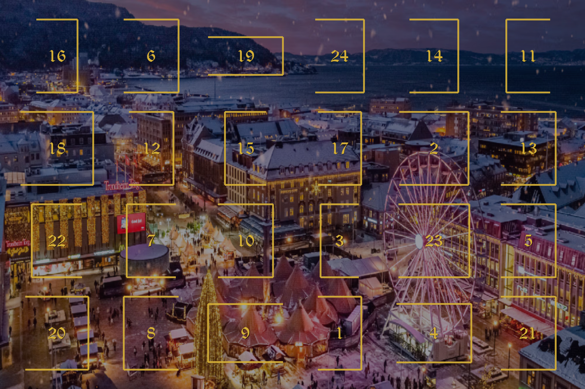

# Adventskalender

Ein kleines Python-Tool, das aus 24 eigenen Fotos einen Fotokalender zum
Ausdrucken baut: ein Blatt mit allen Fotos als Collage, und ein zweites Blatt
mit goldenen Türchen zum Aufschneiden, das exakt darübergelegt wird.



*(Beispielausgabe von `Adventskalender_Tuerchen.png` – die Fotos selbst sind
in diesem Repo bewusst nicht enthalten, siehe unten.)*

## Wie es funktioniert

1. **`scripts/build_calendar.py`** liest alle Fotos aus `Quellfotos/`, sucht
   automatisch das Rasterformat (Spalten × Zeilen, Teiler von 24), dessen
   Zellenform am besten zum durchschnittlichen Seitenverhältnis der Fotos
   passt, und packt jedes Foto unverzerrt (kein Zuschnitt) in seine Zelle.
   Rand und Abstand zwischen allen Fotos: exakt 1 cm. Ergebnis:
   `Adventskalender_Fotos.png` (30 × 20 cm, 300 dpi).
2. **`scripts/build_doors.py`** legt über die exakt gleiche Fläche ein
   zweites Blatt: `Hintegrund.jpg` als Hintergrund, pro Foto ein goldener
   Rahmen in der *exakten Größe des jeweiligen Fotos*, eine zufällig
   gemischte Zahl 1–24 pro Türchen, und eine zufällig gewählte offene Seite
   (links oder rechts) pro Türchen. Ergebnis: `Adventskalender_Tuerchen.png`.

Alle Entscheidungen, Spezifikationen und der Entstehungsverlauf stehen
ausführlich in [`CLAUDE.md`](CLAUDE.md).

## Benutzung

```bash
pip install pillow pillow-heif

# 1. Genau 24 Fotos (.jpg/.jpeg/.png/.heic) in Quellfotos/ ablegen
# 2. Collage bauen
python scripts/build_calendar.py
# 3. Türchen-Blatt bauen
python scripts/build_doors.py
```

Beide erzeugten PNGs bei 100 % Skalierung (nicht „an Seite anpassen") auf
gleich großes Papier drucken, exakt übereinanderlegen, Türchen an den
goldenen Linien aufschneiden und an der linienlosen Seite aufklappen.

Für eine neue zufällige Mischung (Fotoreihenfolge, Türnummern, Öffnungsseite):
`RANDOM_SEED` in den Skripten ändern.

## Warum sind keine Fotos in diesem Repo?

`Quellfotos/` und das daraus erzeugte `Adventskalender_Fotos.png` enthalten
private Fotos und sind deshalb per `.gitignore` ausgeschlossen. `Hintegrund.jpg`
(Hintergrundbild für das Türchen-Blatt) und `Adventskalender_Tuerchen.png`
(enthält keine privaten Fotos, nur Rahmen/Zahlen über dem Hintergrundbild)
sind Teil des Repos.
